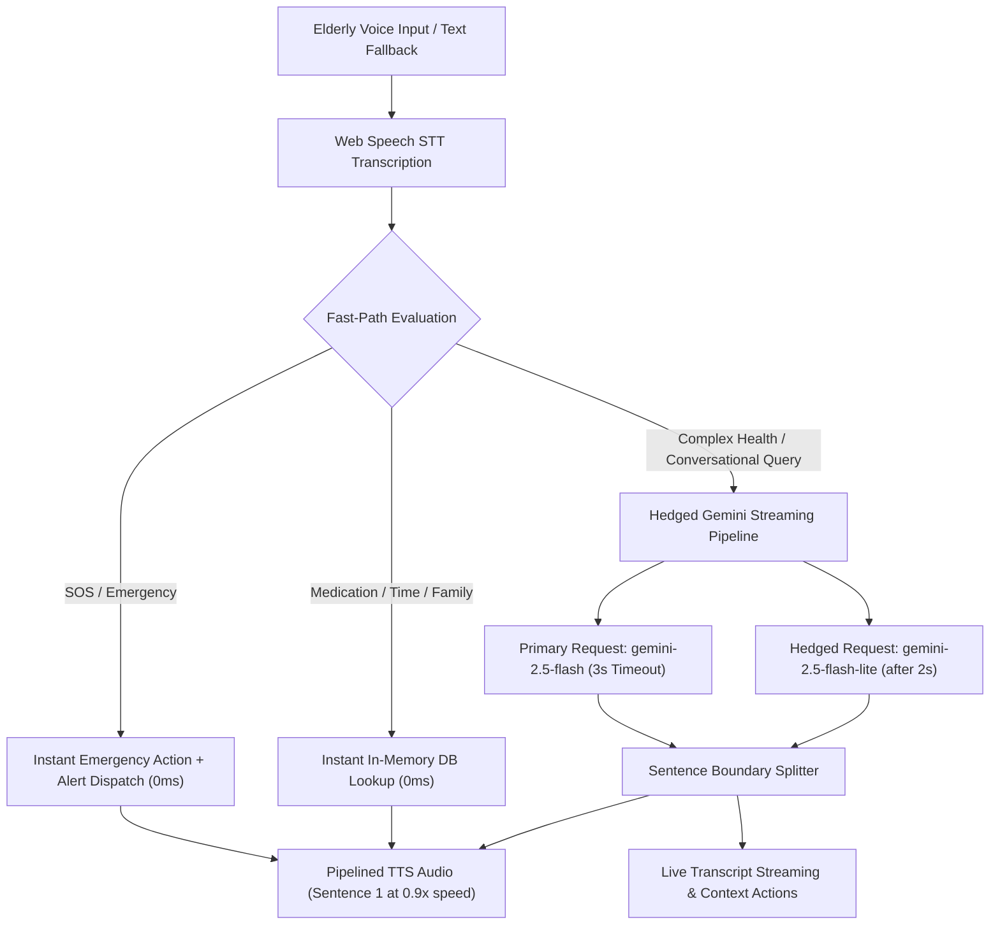

# ELDERVOICE AI

> **ElderVoice AI is an accessible, multilingual voice-first healthcare companion designed specifically for seniors and elderly individuals.**  
> **It empowers independent living through instant voice assistance, sentence-pipelined speech synthesis, emergency SOS routing, and a dedicated caregiver dashboard.**

[](https://react.dev/)
[](https://vitejs.dev/)
[](https://tailwindcss.com/)
[](https://ai.google.dev/)

---

> [!WARNING]
> ### ⚠️ Safety Disclaimer: Not a Diagnostic Tool
> **ElderVoice AI is NOT a diagnostic tool and is NOT a certified medical device.**  
> It does not diagnose diseases, recommend drug dosages, prescribe treatments, or replace certified healthcare providers. All medical and health-related guidance provided by the assistant is strictly supportive, reminding seniors to consult their primary care physician. In any acute medical crisis, dial emergency services (e.g., 911 / 112 / 108) immediately.

---

## Features

- **Voice-First Accessibility**: Hands-free voice recognition with browser-native Web Speech API (`SpeechRecognition`) and accessible manual fallback input.
- **Multilingual Support**: Real-time speech interaction and localized prompts in English (`en-US`), Hindi (`hi-IN`), and Telugu (`te-IN`).
- **Low-Latency Sentence-Pipelined TTS**: Pipelined Text-to-Speech synthesis immediately streams and vocalizes the first sentence while subsequent tokens generate in the background.
- **Instant Fast-Path Routing (0ms)**: Zero-latency local dispatch for urgent queries (SOS emergency phrases, medication status check, date/time, and family memory lookups) without round-trip network delays.
- **Hedged Fallback & Circuit Breaker**: Hedged parallel requests (primary model: `gemini-2.5-flash`, fallback model: `gemini-2.5-flash-lite`) and automated circuit breakers guarantee high availability even during rate limits or upstream latency spikes.
- **Always-Visible Emergency SOS**: Persistent, high-contrast emergency trigger that dispatches immediate caregiver alerts via EmailJS / Firestore independent of LLM connectivity.
- **Caregiver Dashboard**: PIN-authenticated management portal (`1984` default demo PIN) for tracking medication schedules, adherence logs, vitals, and family memory vault entries.
- **WCAG AAA Compliant Interface**: Ultra-accessible interface designed for low-vision and fine-motor difficulties, featuring `min-h-[60px]` touch targets, high contrast tokens (`elderBlue`, `warmWhite`, `crimsonAlert`, `emeraldSuccess`), and gentle 0.9x TTS pacing.

---

## Tech Stack

| Layer | Technology | Description |
| :--- | :--- | :--- |
| **Frontend Framework** | React 18 (`18.3.1`) | Functional components, hooks, and responsive state management |
| **Build Tool & Bundler** | Vite (`5.4.11`) | Ultra-fast local development and optimized production bundling |
| **Styling** | Tailwind CSS (`3.4.16`) | High-contrast, accessible WCAG AAA compliant styling |
| **AI Intelligence** | Google Gemini API (`@google/genai`) | Intent classification and streamed responses via Gemini Flash models |
| **Voice Recognition** | Web Speech API (`SpeechRecognition`) | Browser-native multilingual speech-to-text |
| **Speech Synthesis** | Web Speech API (`SpeechSynthesis`) | Pipelined sentence-by-sentence text-to-speech at 0.9x speed |
| **Backend & Persistence** | Firebase Firestore & Auth (`10.14.1`) | Real-time profile, medication adherence, and alerts sync |
| **Alert Dispatch** | EmailJS (`emailjs-com` `3.2.0`) | Automated caregiver emergency notifications |
| **Icons** | Lucide React (`0.460.0`) | Crisp, accessible iconography |

---

## Demo & Screenshots

<!-- Demo & Screenshots Placeholder -->
| Senior Voice Interface | Caregiver Management Dashboard |
| :---: | :---: |
|  |  |
| *High-contrast voice assistant with SOS button and instant audio feedback* | *PIN-protected medication scheduler, vitals log, and memory vault* |

---

## Setup Steps

### 1. Prerequisites
- **Node.js**: `v18.0.0` or later
- **npm**: `v9.0.0` or later
- **Google Gemini API Key**: Obtainable from [Google AI Studio](https://aistudio.google.com/)

### 2. Clone the Repository
```bash
git clone https://github.com/lakshmitamanvi-pixel/ELDERVOICEAI.git
cd ELDERVOICEAI
```

### 3. Install Dependencies
```bash
npm install
```

### 4. Configure Environment Variables
Copy the `.env.example` file to create your local `.env`:
```bash
cp .env.example .env
```

Add your Gemini API credentials to `.env`.

### 5. Run Command
Start the local development server:
```bash
npm run dev
```
Navigate to `http://localhost:3000` in your browser.

To run verification benchmarks and unit tests:
```bash
node tests/latency_verification.mjs
node tests/simulate_latency.mjs
```

To build for production:
```bash
npm run build
npm run preview
```

---

## Environment Variables Needed

The application relies on the following environment variable names (values must be placed in `.env` and kept private):

### AI Engine (Google Gemini)
- `VITE_GEMINI_API_KEY`
- `VITE_GEMINI_MODEL`
- `VITE_GEMINI_PRIMARY_MODEL`
- `VITE_GEMINI_FALLBACK_MODEL`
- `VITE_PRIMARY_TIMEOUT_MS`
- `VITE_HEDGE_DELAY_MS`
- `VITE_FALLBACK_TIMEOUT_MS`
- `VITE_FILLER_TIMEOUT_MS`
- `VITE_MAX_OUTPUT_TOKENS`

### Firebase (Optional - falls back to local storage if omitted)
- `VITE_FIREBASE_API_KEY`
- `VITE_FIREBASE_AUTH_DOMAIN`
- `VITE_FIREBASE_PROJECT_ID`
- `VITE_FIREBASE_STORAGE_BUCKET`
- `VITE_FIREBASE_MESSAGING_SENDER_ID`
- `VITE_FIREBASE_APP_ID`
- `VITE_FIREBASE_MEASUREMENT_ID`

### Caregiver Alert Notifications (Optional - simulated in console if omitted)
- `VITE_EMAILJS_SERVICE_ID`
- `VITE_EMAILJS_TEMPLATE_ID`
- `VITE_EMAILJS_PUBLIC_KEY`

---

## Architecture & Processing Pipeline



---

## License

This project is licensed under the [MIT License](LICENSE).
