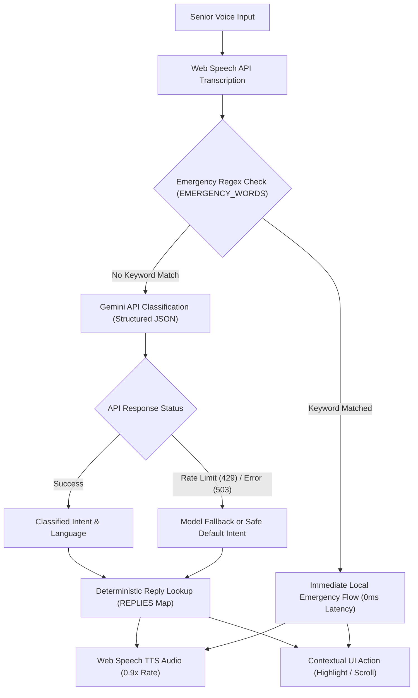

# ELDERVOICE AI

Multilingual voice healthcare companion for seniors.

[](https://react.dev/)
[](https://vitejs.dev/)
[](https://tailwindcss.com/)
[](https://ai.google.dev/)

---

## Problem

- Many seniors experience significant friction with standard digital health apps due to small text, low contrast, and complex navigation menus.
- Language barriers compound these difficulties for non-native English speakers who express health concerns more comfortably in their native language (such as Hindi or Telugu).
- When physical discomfort, falls, or sudden confusion arise, multi-step touchscreen workflows delay access to critical assistance.
- Missed medication schedules and uncoordinated caregiver communication can lead to preventable complications.

---

## Solution & Features

ElderVoice AI provides a high-contrast, voice-first companion interface designed for elderly users, coupled with a real-time caregiver management dashboard.

- **Voice Input**: Captures user speech in real time using the browser's Web Speech API (`SpeechRecognition`), with automatic fallback to text input when speech recognition is unsupported or disabled.
- **Multilingual Support**: Supports English (`en`), Hindi (`hi`), and Telugu (`te`) across speech recognition, prompt classification, and speech synthesis (`SpeechSynthesisUtterance`).
- **Deterministic Intent Routing**: Routes utterances into seven explicit intent categories:
  - `medication`: Directs the user to the medication checklist and highlights today's schedule.
  - `emergency`: Directs the user to the SOS emergency interface.
  - `call_family`: Displays primary contact information and suggests triggering the emergency alert.
  - `appointment`: Directs the user to upcoming clinical visits.
  - `symptom`: Advises contacting a physician immediately and warns against unprescribed medication changes.
  - `greeting`: Welcomes the senior and confirms system readiness.
  - `unknown`: Requests the senior to repeat their statement when the input is unclear.
- **Always-Visible SOS Button**: A persistent, high-contrast emergency button positioned at the top of the senior interface. It functions completely independently of the Gemini API, providing immediate visual and audio feedback, updating status, and dispatching alerts via EmailJS or logging locally even during API outages.
- **Accessible UI**: Minimum touch targets of `min-h-[60px]`, large typography, and a WCAG AAA compliant color scheme (`elderBlue`, `warmWhite`, `crimsonAlert`, `emeraldSuccess`).
- **Caregiver Dashboard**: PIN-protected management portal (default demo PIN: `1984`) for tracking medication adherence, scheduling appointments, reviewing vitals, and updating the family memory vault.

---

## How It Works

ElderVoice AI uses a layered processing pipeline that couples local regex checks with an LLM-based intent classifier.

1. **Voice Input**: The user speaks into the microphone (or enters text into the fallback input field).
2. **Transcription**: The Web Speech API converts audio into a text transcript.
3. **Emergency Regex Gate**: The transcript is checked locally against `EMERGENCY_WORDS` (covering English, Hindi, and Telugu terms such as _help_, _chest pain_, _cannot breathe_, _fell_, _बचाओ_, _मदद_, _సహాయం_). If matched, the system triggers the emergency response immediately without making any API call.
4. **Gemini Intent Classifier**: If no emergency keywords match, the transcript is sent to Google Gemini using a strict system prompt and JSON schema (`responseSchema`). The model returns only `{ intent, language }`.
5. **Fixed Reply Lookup**: The application retrieves the corresponding fixed response from the internal `REPLIES` map based on the detected intent and language.
6. **Feedback & Action**: The fixed reply is read aloud using speech synthesis (at a measured 0.9x speed for senior comprehension) and triggers contextual UI actions (such as scrolling to and highlighting relevant sections).

### Design Choice: Classification Only

> **Design Choice**: The LLM classifies intent and language only; the application writes the replies.
>
> The Gemini model is strictly prohibited from generating freeform medical advice, diagnoses, or conversational text. Keeping reply generation deterministic in application code eliminates hallucinations, prevents medical misinformation, and guarantees predictable, safe output for seniors.

### Architecture Flowchart



---

## Tech Stack

| Category                | Technology                           | Version | Purpose                                                  |
| :---------------------- | :----------------------------------- | :------ | :------------------------------------------------------- |
| **UI Framework**        | React                                | 18.3.1  | Core component architecture and interface state          |
| **Build Tool**          | Vite                                 | 5.4.11  | Development server and production bundling               |
| **Styling**             | Tailwind CSS                         | 3.4.16  | High-contrast WCAG AAA accessible styles                 |
| **AI SDK**              | `@google/genai`                      | 3.3.0   | Intent and language classification with Gemini models    |
| **Speech-to-Text**      | Web Speech API (`SpeechRecognition`) | Native  | Browser-native speech recognition in en-US, hi-IN, te-IN |
| **Text-to-Speech**      | Web Speech API (`SpeechSynthesis`)   | Native  | Slower-rate (0.9x) speech output for clarity             |
| **Database & Sync**     | Firebase (Firestore & Auth)          | 10.14.1 | Profile, medication, and appointment persistence         |
| **Alert Notifications** | EmailJS (`emailjs-com`)              | 3.2.0   | Caregiver email notification dispatch                    |
| **Icons**               | Lucide React                         | 0.460.0 | Accessible iconography                                   |

---

## Project Structure

```
ELDERVOICEAI/
├── .env.example                       # Environment variable template
├── .gitignore                         # Git exclusion rules
├── index.html                         # Application entry HTML
├── package.json                       # Dependencies and scripts
├── package-lock.json                  # Dependency version lockfile
├── postcss.config.js                  # PostCSS configuration for Tailwind
├── tailwind.config.js                 # Tailwind configuration with accessible color tokens
├── vite.config.js                     # Vite build and manual chunking configuration
├── README.md                          # Project documentation
└── src/
    ├── App.jsx                        # Root application component with Senior/Caretaker tabs
    ├── index.css                      # Global stylesheet and Tailwind directives
    ├── main.jsx                       # Application mount entry point
    ├── components/
    │   ├── caretaker/                 # Caregiver dashboard components
    │   │   ├── AdherenceTracker.jsx          # Medication adherence statistics
    │   │   ├── AlertNotificationFeed.jsx     # Emergency and warning alert feed
    │   │   ├── AppointmentManager.jsx        # Doctor visit scheduling and status
    │   │   ├── CaretakerDashboard.jsx        # Caregiver dashboard wrapper
    │   │   ├── ElderlyStatusCard.jsx         # Senior profile and vitals overview
    │   │   ├── MedicationScheduleManager.jsx # Medication schedule CRUD interface
    │   │   ├── MemoryVaultManager.jsx        # Family memories and care routines
    │   │   ├── PinAuthWrapper.jsx            # 4-digit PIN authentication lock
    │   │   └── index.js                      # Caretaker component export index
    │   └── elderly/                   # Senior-facing accessible components
    │       ├── EmergencyAlertButton.jsx      # Standalone, always-visible SOS button
    │       ├── MedicationReminderCard.jsx    # Accessible medication checklist card
    │       ├── SeniorVoiceAssistant.jsx      # Voice recording and assistant interface
    │       └── index.js                      # Elderly component export index
    ├── services/
    │   ├── caretakerService.js        # Firestore sync with localStorage fallback
    │   ├── email.js                   # EmailJS alert dispatch and simulation
    │   ├── firebase.js                # Firebase initialization (Auth & Firestore)
    │   ├── gemini.js                  # Response generator wrapper
    │   ├── geminiService.js           # Regex gate, model fallback, & Gemini classifier
    │   ├── speech.js                  # Unified speech service export wrapper
    │   ├── speechService.js           # STT/TTS engine with browser fallback handling
    │   └── index.js                   # Services export index
    └── utils/
        ├── formatters.js              # Date and time formatting helpers
        ├── multilingual.js            # Translation strings for en, hi, and te
        └── index.js                   # Utilities export index
```

---

## Setup

### Prerequisites

- **Node.js**: version 18.0.0 or higher
- **npm**: version 9.0.0 or higher
- **Google Gemini API Key**: from [Google AI Studio](https://aistudio.google.com/)

### Installation & Execution

1. **Clone the repository**:

   ```bash
   git clone https://github.com/lakshmitamanvi-pixel/ELDERVOICEAI.git
   cd ELDERVOICEAI
   ```

2. **Install dependencies**:

   ```bash
   npm install
   ```

3. **Configure environment variables**:
   Create a `.env` file from `.env.example`:

   ```bash
   cp .env.example .env
   ```

   Set your Gemini credentials in `.env`:

   ```env
   VITE_GEMINI_API_KEY=your_gemini_api_key_here
   VITE_GEMINI_MODEL=gemini-3.5-flash
   ```

   _(Firebase and EmailJS variables are optional; if omitted, the app runs in demo mode using `localStorage` caching and simulated alert logging)._

4. **Start development server**:

   ```bash
   npm run dev
   ```

   Open `http://localhost:3000` in your browser.

5. **Build for production**:

   ```bash
   npm run build
   ```

6. **Preview production build**:
   ```bash
   npm run preview
   ```

---

## Environment Variables

A template file `.env.example` is included in the root directory:

```env
VITE_FIREBASE_API_KEY=your_api_key_here
VITE_FIREBASE_AUTH_DOMAIN=your_project_id.firebaseapp.com
VITE_FIREBASE_PROJECT_ID=your_project_id
VITE_FIREBASE_STORAGE_BUCKET=your_project_id.appspot.com
VITE_FIREBASE_MESSAGING_SENDER_ID=your_sender_id
VITE_FIREBASE_APP_ID=your_app_id
VITE_FIREBASE_MEASUREMENT_ID=your_measurement_id
VITE_GEMINI_API_KEY=your_gemini_api_key_here
VITE_GEMINI_MODEL=gemini-3.8-flash
```

| Variable              | Required                         | Description                                                           |
| :-------------------- | :------------------------------- | :-------------------------------------------------------------------- |
| `VITE_GEMINI_API_KEY` | Yes (for AI voice)               | API key for Gemini model classification                               |
| `VITE_GEMINI_MODEL`   | No (default: `gemini-3.5-flash`) | Primary model name (e.g. `gemini-3.5-flash`, `gemini-3.8-flash`)      |
| `VITE_FIREBASE_*`     | No                               | Firebase project credentials (falls back to local storage if omitted) |

---

## Reliability & Fault Tolerance

- **Pre-API Emergency Regex**: Critical safety phrases (`help`, `emergency`, `urgent`, `chest pain`, `cannot breathe`, `fell`, `ambulance`, `बचाओ`, `मदद`, `సహాయం`, `అత్యవసరం`) are intercepted locally before making network requests. This ensures immediate emergency routing with 0ms network latency.
- **Offline & Standalone SOS**: The `EmergencyAlertButton` component functions independently of the Gemini API. Even during network disconnects or API downtime, pressing the button triggers visual alerts and local dispatch logging.
- **Model Fallback Chain**: The `callWithFallback` routine attempts classification using the configured primary model (`VITE_GEMINI_MODEL`) and automatically rolls over to secondary candidates (such as `gemini-3.5-flash`) if the primary model fails.
- **Error & Rate-Limit Handling (429/503)**: Rate limit errors (`429`), server errors (`500`, `503`), and unavailable models (`404`) are caught without unhandled rejections. The system falls back to `SAFE_FALLBACK_RESPONSE` (`unknown` intent), keeping the UI responsive and encouraging the senior to repeat their request.
- **Speech Engine Resilience**: When browser speech recognition is unavailable or permission is denied, the application surfaces a diagnostic status message and provides an accessible text input field as a fallback.

---

## Limitations & Safety

- **Not a Medical Device**: ElderVoice AI is an assistive prototype for communication and medication reminders. It is not a certified medical device and is not intended for clinical diagnosis or treatment.
- **No Diagnosis or Medication Advice**: The system never prescribes medication, calculates dosages, or diagnoses medical conditions. All medical and symptom queries return fixed guidance directing the senior to consult their doctor.
- **Client-Side Key Exposure**: In this Vite client-side build, `VITE_GEMINI_API_KEY` is bundled into browser assets. This setup is intended strictly for hackathon prototyping and local development. Production deployments require a backend proxy to protect API credentials and enforce access controls.
- **Multilingual Validation**: While Hindi (`hi`) and Telugu (`te`) deterministic replies and UI labels are functional, they require formal clinical and linguistic review by native speakers prior to production use.
- **Speech Recognition Variability**: Accuracy of the browser Web Speech API depends heavily on microphone quality, background noise, and regional dialects or accents.

---

## Future Work

1. **Backend Proxy & Key Security**: Implement a serverless backend proxy to manage Gemini API requests and protect API credentials.
2. **Gemini Multimodal Live API**: Transition to direct bidirectional audio streaming over WebSockets for lower latency and natural voice interaction.
3. **Hardware SOS Integration**: Add support for physical Bluetooth (BLE) panic buttons and wearable fall sensors.
4. **Expanded Regional Dialect Testing**: Conduct acoustic validation with native elderly speakers across regional variations of Hindi and Telugu.
5. **Caregiver Telephony Alerts**: Integrate SMS and automated phone calling (e.g., via Twilio) for critical emergency dispatches.

---

- **ElderVoice AI Team**

### License

This project is licensed under the [MIT License](LICENSE).
